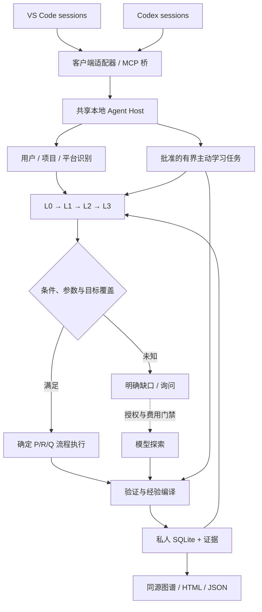
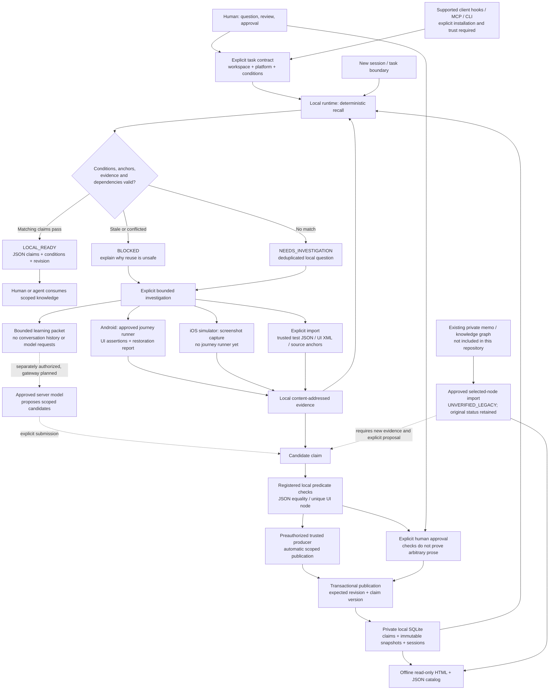
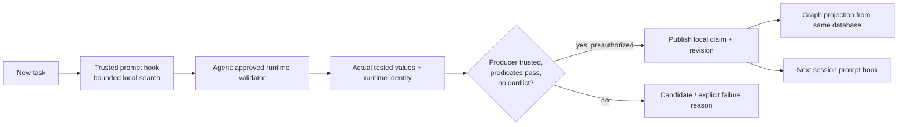

# Clone Yourself

> Your experience. Every session.

A local-first experience agent that helps your coding sessions build on what
you have already learned and verified - instead of starting from scratch.

## What this repository does

**Clone Yourself gives your existing coding agents a shared, private experience
layer on your machine.** It is a headless service, not another chat app or a
replacement for VS Code, Codex, or your chosen model.

An approved task verification can become durable local knowledge. A complete
solution memo records the problem, prerequisites, fixed steps, success checks,
evidence, and limits. A later session can find that experience, check whether it
still applies, and reuse the verified path rather than ask a model to invent it
again.

| Capability | What you get |
|---|---|
| **Shared memory across sessions** | CLI, MCP and supported client hooks connect to one on-demand local Host and private data store. |
| **Automatic capture of verified work** | Preauthorized validators save scoped observations and evidence as part of execution, without an extra "save this" prompt. Ordinary tool output remains unverified. |
| **Reusable solution memos** | Versioned prerequisites (P), bounded procedures (R), and outcome assertions (Q), with explicit parameter and branch coverage. |
| **Progressive recall** | Load a project outline, follow relevant themes, retrieve task summaries, and expand details only when needed - not the whole memory database. |
| **Local-first execution** | Matching verified contracts execute deterministically. Supported readonly pre-model hooks can return a local result without another model inference. |
| **Bounded learning missions** | Explicitly approve source-inspection and revalidation queues with checkpoints, deadlines, permissions and budgets. Model work requires a separately verified cost gateway. |
| **Private, inspectable knowledge** | Generate readable local HTML and matching JSON, inspect provenance, detect conflicts and drift, and delete workspace knowledge. |
| **Preferences without hidden permission grants** | Keep confirmed preferences and unconfirmed habit hypotheses separate from verified facts and action authorization. |

## How it works

```text
New task
  -> Identify the workspace and retrieve relevant local experience
  -> Check prerequisites, verified scope and permissions
       -> Known and applicable: execute the fixed path and verify the result
       -> Missing or unknown: report the gap for authorized investigation
  -> Persist evidence and appropriately scoped knowledge
  -> Make it available to the next session
```

For example, after a file-identity check has been turned into a verified
contract, a new session can repeat that check locally. If the source changes,
the old contract is blocked. A successful check does not become a claim that
the whole project works or that every future version is compatible.

## Important boundaries

- **Local storage is not automatically local inference.** If a client injects
  retrieved text into a cloud model, that selected text is sent to its provider.
- **MCP access is not automatic invocation.** Hooks must be installed, supported
  and trusted; actual client handoffs are diagnosed separately.
- **Verified observations are not automatically verified solutions.** Complete
  workflows, parameter combinations and branch paths need their own checks.
- **No unlimited background learning.** Missions require explicit approval;
  existing paused learning is not resumed by installation.
- **Current shared Host support is macOS/Linux.** A Windows transport is not
  implemented. Arbitrary natural-language requests are not treated as exact
  executable contracts.
- **The repository ships software, not your memories.** Real project knowledge,
  logs, screenshots, account data and generated pages stay outside Git.

## Start here

- [Install on another Mac](#另一台-mac-安装教程)
- [Architecture and delivered capabilities](#v04-目标与交付边界)
- [Complete solution memos](#完整解决-memo)
- [Layered shared memory](#分层共享记忆)
- [Bounded learning missions](#主动学习任务)

**Runtime compatibility:** the package remains `local-learning-runtime`,
the CLI remains `llr`, and private data remains in `~/.local-learning-runtime`.
The repository rename does not require moving existing checkouts or memories.

## 另一台 Mac 安装教程

**安装代码能力，不会带入原机器的私人知识。** 仓库是 public，克隆无需 GitHub
账号授权；提交改动仍需要仓库权限或通过 fork/PR。本教程适用于 macOS、Python 3.9+
及支持对应接口的客户端。核心服务不要求 Android SDK；实际 App 验证才需要相应工具。

### 1. 获取仓库

先准备 Git、Python 3.9+。公开仓库可以直接克隆，不需要 GitHub CLI 或模型账号：

```sh
mkdir -p "$HOME/Developer"
git clone https://github.com/yuzhongqi/clone-yourself.git "$HOME/Developer/clone-yourself"
cd "$HOME/Developer/clone-yourself"
```

不要把 GitHub 密码、认证器验证码或 token 写入命令、仓库和知识文件。

### 2. 在私人虚拟环境安装

不要直接修改 macOS 的共享系统 Python。旧 pip/setuptools 可能生成空的
`UNKNOWN-0.0.0` 包；使用独立环境并更新构建工具：

```sh
python3 -m venv "$HOME/.local/share/llr/venv"
source "$HOME/.local/share/llr/venv/bin/activate"

python -m pip install --upgrade pip setuptools wheel
python -m pip install .
python -m pip show local-learning-runtime

llr host-status
```

当前版本应显示 `local-learning-runtime`、版本 `0.4.0`；`host-status` 返回
`READY`、PID、`state_home`。不要把 `UNKNOWN-0.0.0` 当作安装成功。

**保留该虚拟环境**：安装器生成的客户端配置会引用其中的 Python。新终端执行
`llr` 前重新 activate，或直接使用：

```sh
"$HOME/.local/share/llr/venv/bin/llr" doctor
```

客户端通过绝对路径启动桥接器，不要求你为每次聊天手动 activate。

### 3. 登记该机器的项目

下面的 OfficeMobile 仅是接入示例，不是引擎内置业务。必须把示例路径替换成新 Mac
上的真实 checkout；workspace ID 是稳定业务标识，目录是本机位置。

```sh
PROJECT_ROOT="/替换为实际路径/officemobile/android/JavaKotlin"
```

同一 workspace 的重复 setup 必须使用相同根目录，不会静默重绑定。
iOS 使用另一个 ID（例如 `officemobile/ios`）及 `--platform ios`；
普通项目可使用 `--platform generic`。Android 经验不会自动授予 iOS 验证。

### 4. 接入 VS Code Copilot

```sh
llr setup officemobile/android \
  --root "$PROJECT_ROOT" --platform android \
  --client copilot --approve
```

安装器写入用户级 hooks 和 MCP，不修改 Office 源码，保持已有模型配置。
当前路径针对 Copilot Agent Host／Copilot CLI hook schema。其他 VS Code provider
或旧版本必须单独检查兼容性，不能因同属 VS Code 就认为自动接通。

重新加载 VS Code，检查目标 harness 的 Hooks／MCP 来源，再创建新 chat。
配置存在只表示安装完成；实际触发还需要第 7 步验证。

### 5. 接入 Codex

先安装 MCP 和完成通知（保留已有通知链）：

```sh
llr setup officemobile/android \
  --root "$PROJECT_ROOT" --platform android \
  --client codex --approve
```

支持生命周期 hooks 的 Codex 桌面版本，再安装：

```sh
llr setup officemobile/android \
  --root "$PROJECT_ROOT" --platform android \
  --client codex-hooks --approve
```

在实际 Codex 桌面 App 的 **Settings → Hooks** 中 review/trust 新 hooks，
重新启动客户端并创建新聊天。旧 Codex CLI 没有相同 hook 能力时只能使用 MCP／notify
替代路径；不能把 CLI 测试当成桌面 App 的验收。

可选的本地零推理请求门禁：

```sh
llr setup officemobile/android \
  --root "$PROJECT_ROOT" --platform android \
  --client codex-hooks --local-first-readonly --approve
```

这只会对精确匹配、P/R/Q 已验证的纯文件只读流程返回本地结果并阻止后续模型请求。
新机器记忆库为空时没有可复用流程；不要期望安装本身就能解决所有问题。
不支持该 hook 的客户端仍按其能力等级工作。

默认客户端目录是 `~/.copilot` 或 `~/.codex`。如果实际客户端使用自定义目录，
setup 可加 `--profile "/实际客户端配置目录"`；它不是 agent 的私人数据目录。
多个客户端必须指向同一个 agent `--home`，才能共享同一份记忆。
`--home` 是全局参数，放在子命令前（例如 `llr --home "/私人状态目录" host-status`）。

### 6. 打开父目录时登记发现别名

如果 App 打开 `officemobile` 父目录，而登记的是 `android/JavaKotlin`：

```sh
llr register-alias --workspace officemobile/android \
  --root "/替换为实际路径/officemobile" --require-platform --approve
```

别名只用于发现，不改变源码锚点根目录。多平台父目录需要任务明确平台，否则返回
`AMBIGUOUS`；未登记目录返回 `UNKNOWN_WORKSPACE`。初次验收建议直接打开登记的根目录。

### 7. 验证真实接入

```sh
llr doctor
llr context --cwd "$PROJECT_ROOT" --query "Android" --session install-check --level 0
```

然后在 VS Code／Codex 中创建全新 chat，提出普通项目问题，再运行 `llr doctor`
检查 `recent_handoffs`：

- 实际 session 是否留下交接记录；
- workspace、客户端和时间是否正确；
- hook 是否被信任并触发；
- 有知识时是否引用正确 revision、条件和证据。

**空库不是失败**；没有实际交接凭据则不能声称客户端自动接通。真正的运行验证还需要
登记对应预授权 validator；setup 不授权登录、消息发送、购买、隐私设置变更或任意命令。

### 8. 私人数据、更新与迁移

默认私人状态目录：`~/.local-learning-runtime`。不在 Git checkout 内。
代码、虚拟环境和知识数据是三个不同位置；不要把数据库、HTML、日志或截图推送仓库。
安装不会启动夜间模型学习，也不会迁移旧机器的知识。

更新时先等待活动操作结束，在源码 checkout 拉取最新代码并重新安装：

```sh
llr host-stop
cd "$HOME/Developer/clone-yourself"
git pull --ff-only
python -m pip install --upgrade .
llr host-status
```

上述命令需在第 2 步虚拟环境中执行。如果服务已因空闲退出，`host-stop` 可报告未运行；
不要因此启动或终止其他无关进程。更新后重新启动客户端；hook 定义变化需再次 trust。
实际安装不修改既有模型账号／提供方配置。

本版没有自动跨 Mac 同步／一键安全迁移。**不要直接复制运行中的 SQLite 数据库**。
旧知识包含目录、可执行文件授权、证据条件和私人完整性密钥；迁移需要一致备份、
路径重映射、重新授权及复验。私人 HTML 可作为历史参考，但不能据此把新机器标成已验证。
新 Mac 可先独立使用和积累；正式迁移应走单独审阅的流程。

## v0.4 目标与交付边界

| 目标 | 本版实现 | 不能混淆的边界 |
|---|---|---|
| 跨 session 连续性 | 按需启动的用户级 Unix-socket Host；每个 MCP 进程是薄桥接器 | 当前服务支持 macOS/Linux，Windows named-pipe 适配器尚未交付 |
| 已验证路径复用 | 完整 Solution Memo：问题、参数、前置条件 P、步骤 R、结果检查 Q、证据 | 相似度不授权执行；候选观察不能直接变成完整解决流程 |
| 自动沉淀 | 既有里程碑自动发布；声明问题的批准验证器自动编译解决候选 | 编译候选仍需完整 trial；不自动扩大解决范围 |
| 分层记忆 | L0 项目目录、L1 主题地图、L2 任务包、L3 pinned 展开；显式预算与遗漏数 | 字节预算不等于客户端实际 token/费用预算 |
| 本地优先 | 确定性问题 pattern＋有限已验证参数组合；纯本地 P/R/Q 执行 | 自由自然语言／模糊任务可检索，但不会被猜测为可执行 |
| 零模型路径 | CLI／MCP 受控执行；可选 Codex 只读 prompt gate 直接返回本地结果 | 其他客户端仅注入上下文时不计为零模型接入 |
| 主动学习 | DRAFT→审批→队列、检查点、暂停、恢复、截止与预算；Host 自动推进批准任务 | 默认不允许模型或 App 操作；当前旧学习暂停不会被解除 |
| 个体经验 | 显式偏好及待确认习惯假设；同库派生图谱和 HTML | 偏好不是权限，推测不是事实 |



### 安装与载体

Python 3.9+，无运行时第三方依赖。完整步骤见上方
[另一台 Mac 安装教程](#另一台-mac-安装教程)。
已构建 wheel 不需要重建源码；源码安装需要兼容的构建工具。

也可使用现有 `tools/llr.py`，或发行包自带 `local_learning_runtime/entry.py`。
不用给新客户端手写仓库脚本路径。安装需要一次授权；Codex hooks 必须在实际客户端
review/trust，不绕过 trust。模型账号／提供方配置保持不变。

普通 CLI、hooks 与 MCP 请求自动连接同一个用户级 Host。没有批准任务时 Host
空闲 10 分钟退出；下次按需启动。批准任务在聊天关闭后继续，电脑仍需保持可运行。
不暴露公网端口；IPC 目录仅当前 OS 用户可访问。

```sh
llr host-status
llr doctor
llr host-stop
```

`doctor` 展示真正收到的交接凭据；“配置文件存在”不代表客户端已触发。
旧客户端进程需重新启动以加载新桥接实现。安装包升级后，在没有活动操作时停止旧
Host，再连接新版本。`host-stop` 拒绝中断正在执行的学习步骤。

### 完整解决 memo

Schema：[solution.v1.schema.json](schemas/solution.v1.schema.json)。
一份 contract 有问题 pattern、有限 typed 参数、P 条件、R 步骤、Q 断言、结果和边界。

- 条件：实际文件指纹、显式条件相等、版本固定的解决依赖。
- 步骤：`inspect_file`、已批准的 `run_validator`、结构化 `select`、有界 `branch`。
- 参数：首版使用明确枚举，每个组合都有自己的验证 case；一次成功不验证整个范围。
- 流程：无任意 shell、无动态 eval、无模型临时生成步骤。
- 分支：最多一层、每侧最多 8 步、整体最多 32 步；未实测的分支在执行其动作前拒绝复用。
- 解决依赖及验证器授权变化会阻止旧流程继续使用。

```sh
llr solution-propose /private/solution.json --expected-version 0 --approve
llr solution-verify solution-id --workspace sample/android --session training \
  --invocation case-1 --parameters /private/inputs.json --conditions /private/conditions.json --approve
llr route --cwd /absolute/project --query "ordinary approved task" --session new-session
llr solution-execute solution-id --workspace sample/android --session new-session \
  --invocation request-1 --parameters /private/inputs.json --conditions /private/conditions.json
```

`LOCAL_READY` 不等于已解决：实际 Q 通过才返回 `LOCAL_SOLVED`。未知条件返回
`NEEDS_INPUT`，不适用／失效返回 `BLOCKED`，没有经验返回 `NEEDS_EXPLORATION`。
完整执行持久保存 proof，并保护重复或中断调用不自动重复副作用。

注册 runner 可额外声明 `problem: {intent, goal, patterns}`。其可信验证结果发布后，
自动编译 P/R/Q **候选**；它不会因观察 PASS 就被标成 verified solution。
只读新参数 trial 和新的操作授权也必须区分。

### 分层共享记忆

```sh
llr define-theme /private/theme.json --workspace sample/android --approve
llr context --cwd /absolute/project --query "android" --session S --level 0
llr context --cwd /absolute/project --query "startup" --session S --level 1
llr context --cwd /absolute/project --query "actual task" --session S --level 2
llr context --cwd /absolute/project --query "android" --session S --level 3 \
  --node RETURNED_NODE --revision RETURNED_REVISION --cursor 0
llr context-refresh --session S
```

L0 只给目录，L1 给主题关键点与有限成员，L2 给任务候选及完整条件，
L3 按完整字段展开。默认 6000 UTF-8 bytes，最大 12000；返回遗漏数和 cursor。
单个必要字段超过预算时显式 `ITEM_TOO_LARGE`，不截掉条件保留结论。
本地执行器读取完整 contract，不凭摘要执行。

主题别名、成员和一跳关系属于私人项目配置，不把业务关键词写入引擎。
索引和 summaries 来自一个权威存储；snapshot 固定 revision，任务边界 refresh。
当前使用本地词法匹配，不声称已提供通用语义理解或大型向量索引。

### 客户端关系与本地优先

既有 MCP 增加：
`local_experience_context`、`local_experience_route`、`local_experience_execute`。
普通 task/验证事件继续使用既有 API，不建立平行知识库。

Codex 支持的 UserPromptSubmit hook 自动提供 L2；可选择在 `setup ... --client
codex-hooks --local-first-readonly --approve` 后，让**精确匹配、已验证、纯文件只读**
流程直接完成并 block 后续模型请求，结果通过 hook 消息展示。

不匹配、未知条件、涉及 App 的慢操作不会在 prompt hook 中自动扩大执行范围。
支持其他流程的 CLI／SDK 调用同样零模型；原生聊天仅注入知识的情况仍属于 C2，
不计为零模型。适配器被禁用、未信任或失败必须单独诊断。

### 主动学习任务

Schema：[mission.v1.schema.json](schemas/mission.v1.schema.json)。
问题类型：有界 source inventory、单文件 identity 检查、已验证解决流程复验、
经授权的单次 model explanation。静态 inventory 不代表架构理解完成。

```sh
llr mission-create /private/mission.json
llr mission-control mission-id approve --approve
llr mission-control mission-id start
llr mission-status mission-id
llr mission-control mission-id pause
llr mission-control mission-id resume --approve
```

Host 自动推进 RUNNING 任务。范围、文件总量、时间、请求次数和花费分别有预算。
未批准任务不自动运行。中断／未知 runtime outcome 或已尝试的模型请求不会隐式重放。
CLI `mission-tick` 主要用于显式诊断与验收，正常后台由 Host 驱动。

模型默认关闭。只有私人 `model-gateway.json` 明确登记批准 endpoint、model、rates、
workspace、凭据环境变量及经过外部核实的 hard cap 后才可发送。
发送前预留最坏费用；请求携带 reservation 和 request ID；拒绝重定向；
账单／usage 不明、超额或 credential 缺失会停止，绝不自动重试收费未知请求。
保守地保留 reservation，不把估算冒充实际账单。
现有 Copilot 代理未被该代码自动认定具备费用硬限额，也没有被启动夜间模型循环。

### 个体习惯与知识查看

`preference` 支持明确偏好和 inferred 候选；显式确认与版本检查独立于操作权限。
现有 `export-portal` 继续从本地库生成人可读 HTML 和 agent JSON，并包含解决
contract、任务和学习 mission 状态。memo、graph、index 不是三份可独立编辑的事实。
私人数据、export、证据和客户配置都不上传 GitHub。

## 兼容的 v0.2 功能与详细参考

A client-neutral, offline first implementation of evidence-backed app learning.
It captures observations, checks explicit predicates, publishes reviewed claims,
and recalls applicable knowledge in later sessions.

**This is a working local core, not a promise that an LLM will understand every
fact or that a plugin can intercept every VS Code/Codex/OpenClaw operation.**
No model API, recurring job, private memo import, or account login is started.

## 想了解本地知识：按需生成 HTML

**仓库交付生成能力，不交付私人知识数据。** 当用户说“让我看看本地已经学到了什么”
或“生成人能读的知识页面”时，使用本仓库的本地生成器，而不是上传数据库，也不是
让模型凭聊天记忆重新编写结论。

```text
本机 runtime.sqlite + evidence/
    → catalog：读取指定 workspace 的本地记录并检查完整性
    → export-portal：确定性渲染中文知识卡片
    → 本机 index.html（人阅读）+ catalog.json（agent 读取）
```

从本仓库目录运行，替换下面的示例路径和 workspace：

```sh
python3 -m local_learning_runtime \
  --home /absolute/private/runtime-state \
  export-portal --workspace sample/android \
  --output /absolute/private/knowledge-pages/view-001
```

无需安装额外依赖，不启动模型、网络服务或 app。`--home` 必须放在子命令前；
也可以用 `LLR_HOME` 指定本地状态目录。默认状态目录为
`~/.local-learning-runtime`。

命令返回本地 HTML 路径、JSON 路径、知识 revision，以及发布知识和历史记录数量。
在浏览器打开返回的 `index.html`，即可查看：

- 已发布知识：结论、适用边界、完整性检查结果、相关证据；
- 历史线索：保留原状态，明确标为尚未重新验证；
- 待处理项：候选结论和未解决的问题；
- 证据：可读的断言节点或结果摘要，原始内容按需展开。

页面不是重新“创造”知识。人类视图与 agent JSON 来自同一份本地数据和 revision；
未知内容不补写，检查失败不包装成成功。当前渲染器不调用 LLM：已有中文记录直接
展示，受控验收模板用固定中文说明，其他任意语言的结论保留原文，不保证自动翻译。

### Agent 按需展示协议

1. 确认用户要查看的本地状态目录和 workspace；存在歧义时询问，不默选其他项目。
2. 调用 `export-portal`，将输出放在 Git 仓库之外的新目录，不覆盖旧快照。
3. 向用户返回生成的本地 HTML 链接；有浏览器能力时可打开该文件。
4. 说明这是指定 revision 的离线快照；数据变化后重新生成，不返回旧页面冒充最新结果。
5. 文件缺失、校验失败或 workspace 未登记时明确报告；没有记录就显示空状态，
   不将历史笔记自动升级为已验证知识。
6. 不提交、推送或上传数据库、HTML、JSON、截图、日志和私人知识。
   不为了“展示知识”启动云端学习或额外 app 操作。

这个协议是客户端可以采用的显式调用流程，不是已经安装的自动触发 hook。
运行时完整性检查针对记录条件，不独立证明当前设备或后端环境仍然相同。

实现入口：[knowledge.py](local_learning_runtime/knowledge.py)；
CLI 入口：[cli.py](local_learning_runtime/cli.py)；
回归测试：[test_runtime.py](tests/test_runtime.py)。

## Architecture overview

Solid connections below represent implemented local operations or explicit
caller handoffs. Dashed connections represent planned integrations, not installed
client hooks or automatic model calls. Android has a narrow real-emulator
acceptance result as well as mock tests; iOS is still mock-tested only.



### What is delivered and where knowledge lives

| Layer | Delivered now | Boundary |
|---|---|---|
| Client interface | JSON CLI, stdio MCP, Copilot lifecycle adapter, trust-reviewed Codex desktop hooks | OpenClaw and unsupported clients use explicit APIs; no universal interception |
| App observation | Android capture and bounded journey runner; iOS simulator capture | No real-device acceptance run yet; iOS navigation is not implemented |
| Verification | Exact predicates, retained observation conditions, source/evidence fingerprints | Screenshots alone and model confidence cannot verify a claim |
| Knowledge publication | Preauthorized trusted predicates publish automatically; other evidence remains candidate; version checks and invalidation | No automatic interpretation or promotion of legacy notes |
| Cross-session use | Task search, recall, refresh; supported trusted hooks inject bounded context before each prompt | Callers supply current conditions; task completeness is not inferred |
| Learning escalation | History-free, byte-bounded packet | No model gateway, spend enforcement or recurring scheduler |
| Human access | Offline static HTML knowledge cards and matching JSON catalog | Export is a snapshot, not a live or hosted service |

The GitHub repository delivers **generic software and synthetic tests**, not a
project knowledge corpus. Persistent knowledge stays under `LLR_HOME` (default
`~/.local-learning-runtime`):

```text
private runtime home/
  runtime.sqlite   # observations, candidates, claims, snapshots, sessions, questions
  evidence/        # immutable content-addressed observation blobs
```

Initialization creates this store; the demo does not populate it with real app
knowledge. Explicit graph import copies selected notes as unverified history
without modifying the original memo. Android and iOS retain independent workspace scopes.

### Evidence-to-knowledge delivery workflow

```mermaid
sequenceDiagram
    actor Human
    participant Agent as Human or agent CLI caller
    participant Runtime as Local runtime
    participant App as Authorized app / trusted test
    participant Store as Private knowledge store
    Human->>Agent: Define question, scope, permitted actions and expected result
    Agent->>Runtime: recall(task, session)
    Runtime->>Store: Read published revision; check evidence and dependencies
    Runtime-->>Agent: LOCAL_READY / BLOCKED / NEEDS_INVESTIGATION
    opt Explicitly approved investigation or revalidation
        Agent->>Runtime: Execute Android recipe or import trusted results
        Runtime->>App: Bounded actions and declared assertions
        App-->>Runtime: UI or test observations
        Runtime->>Store: Store evidence with artifact and environment conditions
        Runtime-->>Agent: Goal result and separate restoration result
        Agent->>Runtime: Propose scoped claim referencing evidence
        Runtime-->>Agent: Candidate ID and local verification result
        Human->>Agent: Review statement, evidence scope and approval
        Agent->>Runtime: accept(candidate, expected version, expected revision)
        Runtime->>Store: Atomically publish complete knowledge revision
        Runtime-->>Agent: Published revision
    end
    Agent->>Runtime: New session: recall current task and conditions
    Runtime->>Store: Recheck applicability, anchors, evidence and dependencies
    Runtime-->>Agent: Applicable knowledge, or explicit refusal to reuse
```

The investigation sequence illustrates the Android/trusted-test path. iOS
capture only records a screenshot; trusted XCTest/XCUITest predicate results
must be imported separately. A failed restoration cannot be presented as a
fully successful journey, even if a narrower goal assertion passed.

## Requirements and quick start

Python 3.9+; the runtime has no third-party dependencies. Run from this checkout:

```sh
python3 -m unittest discover -s tests -v
python3 -m examples.demo
python3 -m local_learning_runtime --home /absolute/private/state init
```

The demo uses fictional data in an automatically removed temporary directory.
It publishes a claim, recalls it across separate store instances, and proves
that changing a source anchor blocks reuse. Unit tests also cover a fresh CLI
process, publication rollback, replay deduplication, conflicts, tampered evidence,
platform separation, device locks, and failed restoration.

Optional installation: `python3 -m pip install -e .`, then use `llr` instead of
`python3 -m local_learning_runtime`.

Use an absolute `--home` before each command, or set `LLR_HOME`. The default is
`~/.local-learning-runtime`, outside the code repository. Keep state, screenshots,
logs, account data, and app artifacts out of Git, even in a private repository.
Local OS permissions/encryption remain the owner's responsibility.

## Learning lifecycle

```text
explicit question + environment
  -> deterministic recall
  -> local observation / bounded investigation
  -> proposed claim
  -> predicate checks + human review approval
  -> compare-and-swap publication in one SQLite transaction
  -> next session recall and applicability checks
```

Evidence is copied to content-addressed local blobs. Candidates and snapshots
are immutable and fingerprinted. SQLite transactions publish the complete
snapshot and current revision together; interrupted publication cannot expose
a partial revision. Failed checks cannot promote a candidate.

Every claim is scoped to one registered workspace/platform and an observed
artifact fingerprint. Conditions are exact, typed, conjunctive matches, not
semantic similarity. Source anchors are workspace-relative and checked on
publication and recall. Dependencies pin claim versions; updating or invalidating
a dependency blocks dependent claims until reviewed again.

Publication requires retaining every recorded evidence condition, not merely
the artifact fingerprint. Dropping an account, flag, or OS condition would
broaden the observation's scope and is rejected. Multiple observations can
support a claim only when their recorded conditions agree exactly.

## Register a workspace

```sh
python3 -m local_learning_runtime register sample/android \
  --root /absolute/path/to/android-checkout --platform android
python3 -m local_learning_runtime register sample/ios \
  --root /absolute/path/to/ios-checkout --platform ios
python3 -m local_learning_runtime anchor sample/android relative/source.txt
```

Registration stores paths locally; it does not scan, upload, or mutate the repo.
Android verification never grants iOS verification. A registered ID cannot be
silently rebound to another directory or platform.

## Evidence and claims

Create a local conditions file containing at least `artifact_sha256` (64
lowercase hex digits), and relevant scalar conditions such as account category,
locale, known flags, and OS version. Never store passwords or tokens.

Import a result explicitly:

```sh
python3 -m local_learning_runtime observe --workspace sample/android \
  --event unique-run-result --conditions /private/conditions.json \
  --file /private/results.json --type application/json
```

Supported evidence: JSON, Android UI XML, and PNG observations. JSON must be
produced by a trusted test or reviewed by a human; this runtime cannot prove that
an arbitrary imported JSON assertion genuinely came from an app. PNG alone
cannot pass a deterministic verification check.

A candidate specification:

```json
{
  "id": "theme-dark",
  "workspace": "sample/android",
  "task_type": "theme",
  "statement": "Under the recorded conditions, the selected theme is Dark.",
  "conditions": {
    "artifact_sha256": "<replace with real 64-character fingerprint>",
    "account_kind": "test"
  },
  "anchors": [],
  "checks": [
    {
      "kind": "json_equals",
      "evidence_id": "<returned evidence ID>",
      "pointer": "/selected_theme",
      "expected": "Dark"
    }
  ],
  "dependencies": []
}
```

Use nonempty source anchors when claiming a relationship with code. An empty
anchor list is allowed for a scoped runtime observation; it does not establish
which source revision produced the app.

`json_equals` compares a JSON pointer with an exact typed expected value.
`ui_node` requires exactly one matching node:

```json
{
  "kind": "ui_node",
  "evidence_id": "<UI evidence ID>",
  "selector": {"resource-id": "com.example.app:id/theme"},
  "attributes": {"text": "Dark", "selected": "true"}
}
```

Predicates do not mechanically prove arbitrary prose. Review the statement's
scope and relationship to its checks before approval. UI/source correlation
does not prove a specific call stack executed.

```sh
python3 -m local_learning_runtime propose /private/claim.json
python3 -m local_learning_runtime verify CANDIDATE_ID
python3 -m local_learning_runtime accept CANDIDATE_ID \
  --expected-version 0 --expected-revision none --approve
```

For later publication, use the current revision from recall and the existing
claim version (or 0 for a new claim). Stale compare-and-swap values fail instead
of silently overwriting another session. Identical reviewed publication is NOOP.

Contradictory observations do not automatically refute existing claims. Submit
and review their scope, then explicitly mark the old claim conflicted or stale:

```sh
python3 -m local_learning_runtime invalidate theme-dark \
  --lifecycle conflicted --reason "Describe the conflicting evidence" \
  --expected-version 1 --expected-revision REVISION --approve
```

Historical snapshots remain readable; invalidated claims cannot satisfy recall.

## Running Android journeys

Requires `adb`, an explicit device serial, an installed test app, and approval.
Do not use a production account. This runtime never signs in for you.

Read-only capture of an already visible app:

```sh
python3 -m local_learning_runtime capture-android \
  --workspace sample/android --device SERIAL --app com.example.app \
  --context /private/context.json --approve
```

The context file excludes `artifact_sha256`: the adapter calculates a sorted
multi-APK identity from installed APK hashes. It records API level and package,
checks the identity again afterward, captures XML/PNG, and requires the requested
package to appear in the XML. XML and screenshot are sequential observations,
not an atomic snapshot. Capture does not execute a user journey.

Approved recipe execution:

```sh
python3 -m local_learning_runtime run-android /private/recipe.json --approve
```

Recipe shape (IDs below are fictional):

```json
{
  "workspace": "sample/android",
  "device": "SERIAL",
  "app": "com.example.app",
  "context": {"account_kind": "test"},
  "steps": [
    {"action": "launch"},
    {"action": "assert_node", "resource_id": "com.example.app:id/home",
     "attributes": {"enabled": "true"}}
  ],
  "restore": [
    {"action": "assert_node", "resource_id": "com.example.app:id/home",
     "attributes": {"enabled": "true"}}
  ]
}
```

Allowed actions: `launch`, `restart` (force-stop and relaunch), `back`,
`tap_node`, `assert_node`. Tap uses a unique enabled app node's resource ID and
bounds, not model-provided shell commands. Node discovery retries at most five
times. Each command has a timeout; lists have at most 32 steps per phase.
This is a bounded runner, not an automatic explorer or a universal UI test tool.

**Review the entire recipe before approval.** A tap can alter privacy settings,
delete data, or initiate a paid request; semantic button safety cannot be inferred
from its ID. Such actions need separate user consent. No typing, arbitrary
commands, install, consent dismissal, or permission-grant operations are exposed.

Restoration runs even when goal execution fails. Tapping recipes require explicit
restoration steps. Restoration is PASS only with a successful restoration
assertion; otherwise it is NOT_VERIFIED or FAIL. Overall PARTIAL is not success.
Goal evidence remains separately usable after review, even when restoration fails.
App relaunch is not claimed to be a reboot or a full OS process-death experiment.

Device operations are mutually exclusive within one state directory. A killed
process leaves a lock; confirm it stopped before explicit recovery:

```sh
python3 -m local_learning_runtime unlock-device android:SERIAL --approve
```

Other tools/state directories are not covered by this lock. Use a dedicated
device or external exclusive runner for stronger isolation.

## iOS

`capture-ios` uses `xcrun simctl` with an explicit simulator UUID:

```sh
python3 -m local_learning_runtime capture-ios \
  --workspace sample/ios --device SIMULATOR_UUID --app com.example.app \
  --context /private/context.json --approve
```

It hashes the installed app bundle and captures a screenshot. It does not prove
the app is foreground, navigate UI, or promote the image to a verified claim.
Import JSON predicates from a trusted XCTest/XCUITest runner for verification.
Physical iOS devices and an XCUITest journey runner are not implemented yet.

## New sessions and learning gaps

Task file:

```json
{
  "workspace": "sample/android",
  "task_type": "theme",
  "conditions": {
    "artifact_sha256": "<current artifact fingerprint>",
    "account_kind": "test"
  }
}
```

```sh
python3 -m local_learning_runtime recall /private/task.json --session session-b
python3 -m local_learning_runtime refresh --session session-b
python3 -m local_learning_runtime questions
python3 -m local_learning_runtime learning-packet /private/task.json \
  --question "Which exact condition remains unverified?"
```

Recall returns LOCAL_READY only for matching published claims whose evidence,
anchors, and dependencies still pass. Any stale matching claim makes the result
BLOCKED, even when another claim passes. No match returns NEEDS_INVESTIGATION and
deduplicates a local queue item. This proves registered predicate applicability,
not complete coverage of the user's task or deterministic natural-language understanding.

`refresh` reports changed versions and anchor/evidence drift; it does not silently
switch an existing session's knowledge packet. Recall again to adopt a revision
and recheck the actual environment. Callers supply environment conditions; this
core does not independently attest account state or remote flags.

Learning packets contain one bounded question and at most four matching claim
summaries, with omission counts. They exclude conversation history and reject
packets above 12000 UTF-8 bytes. This is a byte cap, not a token or spend cap.
Use an explicitly authorized fresh model session only when needed. Review and
redact any internal data before sending it to an approved provider.

## VS Code / Codex / OpenClaw integration

### 同一 checkout，不同 VS Code session 如何找到同一份知识

知识不存放在聊天历史中。每个 session 都通过相同的 `LLR_HOME` 读取本地数据库，
用当前目录匹配已登记的 workspace，再获取同一 published revision。

从任意工作目录调用仓库自带 launcher，无需先 `cd` 到 runtime 或安装 Python 包：

```sh
python3 /absolute/path/clone-yourself/tools/llr.py \
  discover --cwd /absolute/path/to/project --session unique-session-id
```

`discover` 按真实目录边界匹配，优先最具体的登记根目录。相同目录对应多个平台时
返回 `AMBIGUOUS`，可用 `--platform android` 或 `--platform ios` 消歧；未登记目录
返回 `UNKNOWN_WORKSPACE`，不会因为路径字符串前缀相似就读取其他项目。

结果包含 workspace、state_home、知识 revision、发布知识 ID、任务类型及未验证历史
大纲；每类最多显示 16 个条目并报告遗漏数。它不会把“找到了知识”当成“当前条件下
可直接执行”。下一步：

桌面 App 可能打开整个 monorepo/project 根目录，而不是登记的子模块目录。
可显式登记包含原 checkout 的父目录别名，保持源码锚点根目录不变：

```sh
python3 /absolute/path/clone-yourself/tools/llr.py register-alias \
  --workspace sample/android --root /absolute/path/to/project-root \
  --require-platform --approve
```

父目录别名建议要求平台。`search` 只在实际问题明确且唯一提到 Android/安卓或
iOS/苹果时消歧；未提平台、同时提两个平台时不会默选。别名不能指向无关目录或
文件系统根目录，也不自动登记其他 checkout。必须在真实桌面 App 中验证：
终端 CLI 从子目录成功，不代表 App 从项目根目录也能成功。

```sh
python3 /absolute/path/clone-yourself/tools/llr.py \
  catalog --workspace RETURNED_WORKSPACE
```

真正复用结论仍需 `recall` 和当前条件。每次发现会记录独立 session 读取凭据，
用于比较不同 session 是否访问了同一个知识库和 revision。

可复用的个人指令模板在
[adapters/vscode-session.instructions.md](adapters/vscode-session.instructions.md)。
替换模板路径后，安装到当前客户端实际支持的用户指令位置；不要提交本机路径或
私人数据。示例 Copilot CLI 用户入口为 `~/.copilot/instructions/`，其他 VS Code
provider/profile 的位置和加载状态需单独确认。

验收必须分开：

1. **数据层**：不同工作目录中的独立 CLI 进程返回相同 workspace/revision/知识 ID。
2. **入口层**：实际新 VS Code chat 能看到用户指令，并调用 discover/catalog。
3. **使用层**：新 session 引用正确知识且保留条件与未验证状态。

进程测试不等于真实 chat 验收；指令已保存也不等于每次必然调用。本地代码无法
保证模型自觉遵守，强制执行需要客户端 hook 或受控执行网关。

All three can invoke the same CLI and consume JSON. Client configurations are
only installed with explicit approval; never silently installed or modified.

1. Explicitly normalize the task into the task schema.
2. Run recall before planning or after compaction.
3. Use LOCAL_READY claims within their declared scope.
4. Stop controlled execution on BLOCKED; investigate NEEDS_INVESTIGATION.
5. For an authorized new question, pass only the learning packet to a fresh session.
6. Submit structured candidates, verify, review, and publish.
7. Refresh at task boundaries.

Do not let a model-provided summary or confidence score bypass checks. Plain
instructions/MCP availability cannot guarantee invocation. Global enforcement
requires a client-owned execution gateway or isolated worktree plus acceptance
gate; neither is supplied by this CLI. Source code in a trusted local process can
alter the database, so these checks are not an adversarial sandbox.

## Current boundaries

- No autonomous learning scheduler, model calls, spend gateway, or automatic
  authentication. Model budget remains paused unless separately approved.
- No semantic retrieval, complete dependency discovery, automatic source tracing,
  or dedicated VS Code extension. MCP retrieval and a preapproved validator
  registry are implemented; they do not authorize arbitrary commands.
- No automatic promotion or modification of existing private memo stores.
- No global guarantee that a server-hosted chat uses zero model calls; only this
  runtime's local operations make zero model requests.
- Android launch, capture, restart assertions and cross-process knowledge reuse
  have passed one authorized real emulator acceptance run. That narrow result
  does not validate every Android feature, device, account, or iOS adapter.

## Automatic task milestones (v0.2)

The normal supported path does **not** require a follow-up "save knowledge"
request. Use a previously approved runtime validator to do the task; its result
is minimized, mechanically checked, persisted and indexed as part of execution.



### Preauthorization, once per workspace and runner

```sh
python3 -m local_learning_runtime authorize-local --workspace sample/android --approve
python3 -m local_learning_runtime register-runner example /private/runner.json \
  --workspace sample/android --approve
```

An approved runner has an absolute executable, fixed argv, conditions, explicit
JSON pointer predicates, source anchors and a task title. Executable and file
arguments are fingerprinted. A changed executable or file is rejected before
running. Approval authorizes that exact runtime action, **not** new commands,
App purchases, consent changes, extra agents or model calls.

```json
{
  "argv": ["/absolute/python3", "/private/approved-runtime-check.py"],
  "title": "Example panel visible after launch",
  "conditions": {"artifact_sha256": "<recorded fingerprint>"},
  "conditions_pointer": "/conditions",
  "checks": [{"pointer": "/visible", "expected": true}],
  "anchors": []
}
```

`conditions_pointer` is optional. When supplied, the trusted producer returns
the actual installed artifact/environment identity, instead of reusing a static
registration-time identity. Missing or changed conditions never establish
compatibility with historical knowledge.

Clients discover `local_learning_validators`, then invoke
`local_learning_validate` with task/session/milestone identifiers. The tool
cannot register a new runner or broaden its scope. Direct CLI equivalent:

```sh
python3 -m local_learning_runtime run-validator example --workspace sample/android \
  --session session-a --task task-one --milestone checkpoint-one
```

Preauthorized `run-android` journeys also produce automatic milestones; pass
`--session` and `--task` to associate them with the current client task.
The generic `probe-android-node` producer supports fixed, approved launch and
unique/enabled-node checks; project/package/node values belong in private runner
configuration, never in the product implementation.

### Outcome, authority and retry semantics

Session, task and milestone are separate IDs. One session can have many tasks,
each with several checkpoints. Schema:
[milestone.v1.schema.json](schemas/milestone.v1.schema.json).

- Trusted runtime producers + passing scoped predicates + local preauthorization:
  automatic publication, no per-observation approval click.
- External structured events, code inference, user evidence, screenshots alone
  and hypotheses: durable candidates, not automatically verified facts.
- FAIL, PARTIAL, INCONCLUSIVE or a missing predicate: no success promotion.
- Sensitive predicate values changed by redaction: publication refused.
- Explicit contradictions/supersessions: candidate pending human reconciliation;
  related old knowledge is blocked from automatic search reuse.
- Assistant "done" text and tool transport success: never runtime success.
- Same task/milestone payload: idempotent. Changed payload: reject; use a new
  milestone rather than overwrite prior evidence.
- A publication failure leaves a SAVE_FAILED record and explicit reason;
  the same event can be retried after the error is fixed.
- Trusted eligible events have a private local integrity attestation. A repeated
  validator invocation reuses its existing result; `retry-milestone EVENT_ID`
  retries publication from stored evidence without re-executing the App.
  Concurrent invocation IDs are reserved before execution. An interrupted
  invocation with unknown outcome is reported, not silently rerun.
- SQLite publication is transactional. Candidate collection and publication
  are separately observable phases; a collected file is not a published claim.

Memo, conditions, operations and evidence relations are projected from the same
authoritative database. `graph` does not maintain another independently editable
fact store. Supported links include supports, contradicts, supersedes and
depends_on; relations require existing same-workspace observations.

```sh
python3 -m local_learning_runtime task-status
python3 -m local_learning_runtime graph --workspace sample/android
python3 -m local_learning_runtime search --cwd /project \
  --query "actual business question" --session session-b
```

Search returns at most four summaries within 8000 UTF-8 bytes. No supplied current
conditions means CONDITIONS_UNKNOWN, not unconditional reuse. It includes
provenance, evidence IDs and revision. Full evidence is expanded only as needed.
Runtime is the published-observation authority; Userbot is supplemental legacy
background. Reading only Userbot cannot count as reading newly published runtime
knowledge.

### Installed client adapters and trigger guarantees

```sh
python3 -m local_learning_runtime install-client copilot \
  --runtime-root /absolute/clone-yourself --profile ~/.copilot --approve
python3 -m local_learning_runtime install-client codex \
  --runtime-root /absolute/clone-yourself --profile ~/.codex --approve
python3 -m local_learning_runtime install-client codex-hooks \
  --runtime-root /absolute/clone-yourself --profile ~/.codex --approve
```

| Client path | Actual integration | Guarantee boundary |
|---|---|---|
| VS Code Copilot Agent Host / Copilot CLI | User lifecycle hooks + MCP search/approved validation | Verify the selected harness loads hooks; other VS Code providers have different schemas |
| Codex desktop with supported hooks | UserPromptSubmit injects bounded relevant knowledge; PostToolUse records minimal checkpoints; Stop reports status | New hooks require actual client trust review; never bypass trust |
| Older Codex CLI without hooks | MCP plus user instruction; chained existing notify preserved | Prompt retrieval selection is advisory; notify alone does not capture all validation output |
| Other clients | CLI/MCP and structured milestone API | No lifecycle guarantee until an adapter is installed and actually verified |

The supported hook path injects relevant knowledge before model reasoning,
rather than hoping the model chooses a recall command. Hooks can be disabled,
untrusted, or fail due to environment problems; these are explicit unsupported/
failure states, not successful recall. An LLM can still misinterpret evidence:
controlled execution and predicate checks enforce behavior, not universal
semantic correctness of every answer.

Ordinary PostToolUse capture keeps minimal tool status and at most 16 bounded
debugger assignments, not whole conversations or arbitrary raw output.
They remain candidates because arbitrary stdout is not trusted attestation.
Stop/notify never infer success from the assistant's last message, do not launch
experiments, and do not retry a model in a loop.

### Privacy, durable evidence and deletion

Automatic producers store only values actually used by registered predicates,
not unrelated stdout fields. Known token, receipt, signature, email, order,
device and account identifiers are redacted with private keyed markers; distinct
private conditions remain distinct. Evidence must retain its tested value:
if a predicate relies on a redacted field, it cannot be silently marked PASS.
This deterministic sanitizer is not a universal PII detector. Unstructured
text and new sensitive formats need reviewed minimization, not auto-promotion.

Historical debugger files can be imported as line-located assignments:

```sh
python3 -m local_learning_runtime import-debugger /private/old-debugger.log \
  --workspace sample/android --session source-session --task source-task \
  --title "Scoped historical observation" --approve
```

Only necessary assignments and provenance are retained locally; a historical
log, unknown artifact or old screenshot is not current runtime verification.
Runtime evidence is copied into private content-addressed blobs, independent
of temporary session files.

```sh
python3 -m local_learning_runtime forget-workspace --workspace sample/android --approve
```

Deletion revokes associated historical snapshots and removes authoritative
memo/graph/evidence. Separately exported HTML/JSON, original imports and OS
backups remain owner-managed. Deletion does not revoke runner authorization.
Generated portal JSON includes task-level states and the graph projection.

The runtime makes zero model requests and never starts recurring learning.
Existing client model use remains subject to user/provider authorization and
billing; this software does not implement a provider spend gateway.

### Actual closed-loop acceptance

On 2026-10-14, a new real VS Code Copilot task executed an approved Android
runtime validator. No "save knowledge" instruction was appended: the validation
tool automatically captured, checked and published a new object-specific claim.
A completely new **Codex desktop App** conversation then received that claim
from a trusted UserPromptSubmit hook, with no knowledge IDs, paths or recall
commands in the business question. It cited the exact runtime object,
conditions and evidence, while retaining CONDITIONS_UNKNOWN for the current
environment. The consumer made zero explicit retrieval tool calls: injection
was driven by the client lifecycle hook, not model selection.

This acceptance also caught and fixed parent-project directory discovery,
invalid milestone rejection before App actions, and insufficient object identity
in result summaries. CLI sessions and desktop sessions are separate acceptance
surfaces; their results are not interchangeable. The private report and raw
evidence stay on the local machine. The repository contains only generic code,
schemas, adapters, documentation and synthetic regression tests.

The guarantee applies to installed/trusted supported hooks and preauthorized
validator paths. Arbitrary tools, disabled hooks and unregistered workspaces
remain explicit gaps, not universal success.

## Selected legacy knowledge intake

```sh
python3 -m local_learning_runtime import-graph /private/graph.json \
  --workspace sample/android --node J05 --node F06 --approve
python3 -m local_learning_runtime catalog --workspace sample/android
```

The input is a JSON object with a `nodes` list; nodes have unique IDs. At most
16 selected nodes are copied per call, each at most 12000 UTF-8 bytes. Source
fingerprint, scope, recorded source revision, original status, and full selected
node body are retained. Repeated imports of the same selection/revision deduplicate.
Import never creates an active claim or a passing verification; a historical
`partial` or `observed` node stays `UNVERIFIED_LEGACY` in the new runtime.
New runtime evidence, predicate checks, a scoped proposal, and approval are
required for publication.

## Human knowledge portal and agent catalog

```sh
python3 -m local_learning_runtime export-portal --workspace sample/android \
  --output /private/portal/revision-1
```

Open the returned `index.html` locally in a browser. Its sibling `catalog.json`
contains the same claims, revision, unverified legacy intake, unpublished
candidates, and investigation queue for agent consumption. Published claims
include local integrity status. Conditions remain recorded conditions, not an
attestation of the current device. Referenced evidence is embedded in the page
after fingerprint checking, with a 32 MiB total evidence cap.

The human view uses Chinese knowledge cards: conclusions, reuse limits,
historical gaps and next actions appear first. Conditions, IDs and raw evidence
are collapsed by default. Evidence links show readable labels and relevant UI
nodes rather than a full XML dump. The agent JSON retains the original schema.
Only the exact registered restart-acceptance statement receives a deterministic
Chinese explanation; other statements are preserved rather than guessed or
translated by a model.

The portal is static, read-only, offline, escaped HTML with no scripts or remote
assets. Choose a fresh output directory for each export; existing files are not
overwritten. Re-export after publication or source/evidence drift. The HTML and
JSON can contain private data: do not commit, host publicly, or upload them.
Agent execution must still use `recall`; the catalog is not an execution permit.

## Reproducible real Android acceptance

```sh
python3 -m local_learning_runtime acceptance-android \
  --workspace sample/android --device SERIAL --app com.example.app \
  --resource-id com.example.app:id/navigation \
  --context /private/context.json --output /private/acceptance/run-1 --approve
```

First inspect the installed test app and choose one unique stable enabled UI
node. This command intentionally launches and force-stops/relaunches that app,
but does not tap buttons, send messages, log in, or change privacy settings.
Use a dedicated approved emulator/account; relaunching a production app can
still affect an in-progress user task.

The command:

1. Runs launch -> node assertion -> restart -> node assertion.
2. Separately verifies the same non-mutated observable UI postcondition.
   It does not restore unobserved draft or backend state.
3. Stores real UI XML and the goal/restoration report with installed artifact identity.
4. Publishes only the narrow declared UI observation after approval and checks.
5. Starts an independent CLI process to recall that claim.
6. Starts another process with a changed artifact and requires BLOCKED.
7. Proposes a deliberately false predicate, requires rejection, and checks that
   the published revision did not change.
8. Exports the offline human portal and JSON catalog, plus `acceptance.json`.

This is an actual device runner, not a mocked demo. The local output includes
the recipe, journey, task, changed task, acceptance report and portal. Evidence
remains in the private runtime store. A failed/partial journey stops publication
and leaves its report for investigation. Claims do not assert source execution
or authenticated account identity.

An authorized API35 emulator acceptance on 2026-10-10 passed all eight steps.
Real execution exposed two issues missed by mocks: `monkey` launch failed on
that emulator, and randomized APK paths used `~~`. The adapter now resolves and
starts the launcher via Activity Manager and permits valid randomized paths;
both have regression tests. Private app details and evidence are not in this repo.
