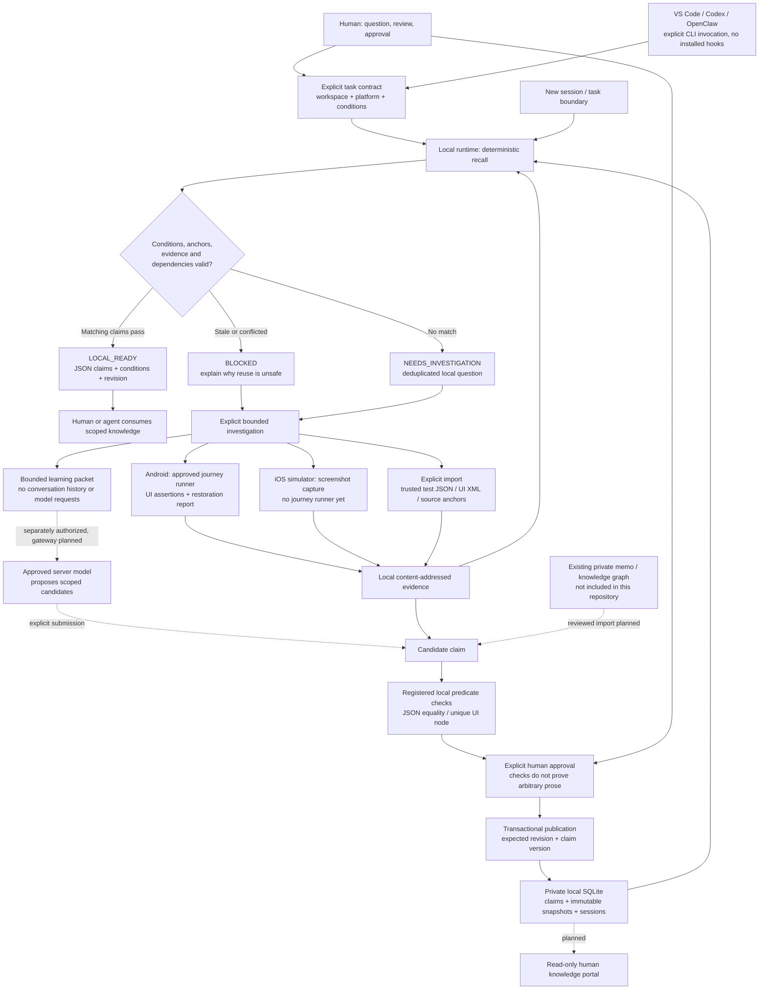

# Local Learning Runtime

A client-neutral, offline first implementation of evidence-backed app learning.
It captures observations, checks explicit predicates, publishes reviewed claims,
and recalls applicable knowledge in later sessions.

**This is a working local core, not a promise that an LLM will understand every
fact or that a plugin can intercept every VS Code/Codex/OpenClaw operation.**
No model API, recurring job, private memo import, or account login is started.

## Architecture overview

Solid connections below represent implemented local operations or explicit
caller handoffs. Dashed connections represent planned integrations, not installed
client hooks or automatic model calls. Device adapters are mock-tested; real app
verification must be performed separately on authorized devices.



### What is delivered and where knowledge lives

| Layer | Delivered now | Boundary |
|---|---|---|
| Client interface | JSON CLI callable by humans and agents | No automatic VS Code/Codex/OpenClaw interception |
| App observation | Android capture and bounded journey runner; iOS simulator capture | No real-device acceptance run yet; iOS navigation is not implemented |
| Verification | Exact predicates, retained observation conditions, source/evidence fingerprints | Screenshots alone and model confidence cannot verify a claim |
| Knowledge publication | Reviewed candidates, version checks, immutable SQLite snapshots, explicit invalidation | No automatic interpretation or promotion of legacy notes |
| Cross-session use | Recall, refresh, dependency checks, deduplicated investigation queue | Callers supply current conditions; task completeness is not inferred |
| Learning escalation | History-free, byte-bounded packet | No model gateway, spend enforcement or recurring scheduler |
| Human access | This README, CLI JSON and local evidence | Rendered knowledge cards and a browser portal are planned |

The GitHub repository delivers **generic software and synthetic tests**, not a
project knowledge corpus. Persistent knowledge stays under `LLR_HOME` (default
`~/.local-learning-runtime`):

```text
private runtime home/
  runtime.sqlite   # observations, candidates, claims, snapshots, sessions, questions
  evidence/        # immutable content-addressed observation blobs
```

Initialization creates this store; the demo does not populate it with real app
knowledge. Existing private memo remains in its original store until explicitly
reviewed and imported. Android and iOS retain independent workspace scopes.

### Evidence-to-knowledge delivery workflow

```mermaid
sequenceDiagram
    actor Human
    participant Agent as Human or agent CLI caller
    participant Runtime as Local runtime
    participant App as Authorized app / trusted test
    participant Store as Private knowledge store
    Human->>Agent: Define question, scope, permitted actions and expected result
    Agent->>Runtime: recall(task, session)
    Runtime->>Store: Read published revision; check evidence and dependencies
    Runtime-->>Agent: LOCAL_READY / BLOCKED / NEEDS_INVESTIGATION
    opt Explicitly approved investigation or revalidation
        Agent->>Runtime: Execute Android recipe or import trusted results
        Runtime->>App: Bounded actions and declared assertions
        App-->>Runtime: UI or test observations
        Runtime->>Store: Store evidence with artifact and environment conditions
        Runtime-->>Agent: Goal result and separate restoration result
        Agent->>Runtime: Propose scoped claim referencing evidence
        Runtime-->>Agent: Candidate ID and local verification result
        Human->>Agent: Review statement, evidence scope and approval
        Agent->>Runtime: accept(candidate, expected version, expected revision)
        Runtime->>Store: Atomically publish complete knowledge revision
        Runtime-->>Agent: Published revision
    end
    Agent->>Runtime: New session: recall current task and conditions
    Runtime->>Store: Recheck applicability, anchors, evidence and dependencies
    Runtime-->>Agent: Applicable knowledge, or explicit refusal to reuse
```

The investigation sequence illustrates the Android/trusted-test path. iOS
capture only records a screenshot; trusted XCTest/XCUITest predicate results
must be imported separately. A failed restoration cannot be presented as a
fully successful journey, even if a narrower goal assertion passed.

## Requirements and quick start

Python 3.9+; the runtime has no third-party dependencies. Run from this checkout:

```sh
python3 -m unittest discover -s tests -v
python3 -m examples.demo
python3 -m local_learning_runtime --home /absolute/private/state init
```

The demo uses fictional data in an automatically removed temporary directory.
It publishes a claim, recalls it across separate store instances, and proves
that changing a source anchor blocks reuse. Unit tests also cover a fresh CLI
process, publication rollback, replay deduplication, conflicts, tampered evidence,
platform separation, device locks, and failed restoration.

Optional installation: `python3 -m pip install -e .`, then use `llr` instead of
`python3 -m local_learning_runtime`.

Use an absolute `--home` before each command, or set `LLR_HOME`. The default is
`~/.local-learning-runtime`, outside the code repository. Keep state, screenshots,
logs, account data, and app artifacts out of Git, even in a private repository.
Local OS permissions/encryption remain the owner's responsibility.

## Learning lifecycle

```text
explicit question + environment
  -> deterministic recall
  -> local observation / bounded investigation
  -> proposed claim
  -> predicate checks + human review approval
  -> compare-and-swap publication in one SQLite transaction
  -> next session recall and applicability checks
```

Evidence is copied to content-addressed local blobs. Candidates and snapshots
are immutable and fingerprinted. SQLite transactions publish the complete
snapshot and current revision together; interrupted publication cannot expose
a partial revision. Failed checks cannot promote a candidate.

Every claim is scoped to one registered workspace/platform and an observed
artifact fingerprint. Conditions are exact, typed, conjunctive matches, not
semantic similarity. Source anchors are workspace-relative and checked on
publication and recall. Dependencies pin claim versions; updating or invalidating
a dependency blocks dependent claims until reviewed again.

Publication requires retaining every recorded evidence condition, not merely
the artifact fingerprint. Dropping an account, flag, or OS condition would
broaden the observation's scope and is rejected. Multiple observations can
support a claim only when their recorded conditions agree exactly.

## Register a workspace

```sh
python3 -m local_learning_runtime register sample/android \
  --root /absolute/path/to/android-checkout --platform android
python3 -m local_learning_runtime register sample/ios \
  --root /absolute/path/to/ios-checkout --platform ios
python3 -m local_learning_runtime anchor sample/android relative/source.txt
```

Registration stores paths locally; it does not scan, upload, or mutate the repo.
Android verification never grants iOS verification. A registered ID cannot be
silently rebound to another directory or platform.

## Evidence and claims

Create a local conditions file containing at least `artifact_sha256` (64
lowercase hex digits), and relevant scalar conditions such as account category,
locale, known flags, and OS version. Never store passwords or tokens.

Import a result explicitly:

```sh
python3 -m local_learning_runtime observe --workspace sample/android \
  --event unique-run-result --conditions /private/conditions.json \
  --file /private/results.json --type application/json
```

Supported evidence: JSON, Android UI XML, and PNG observations. JSON must be
produced by a trusted test or reviewed by a human; this runtime cannot prove that
an arbitrary imported JSON assertion genuinely came from an app. PNG alone
cannot pass a deterministic verification check.

A candidate specification:

```json
{
  "id": "theme-dark",
  "workspace": "sample/android",
  "task_type": "theme",
  "statement": "Under the recorded conditions, the selected theme is Dark.",
  "conditions": {
    "artifact_sha256": "<replace with real 64-character fingerprint>",
    "account_kind": "test"
  },
  "anchors": [],
  "checks": [
    {
      "kind": "json_equals",
      "evidence_id": "<returned evidence ID>",
      "pointer": "/selected_theme",
      "expected": "Dark"
    }
  ],
  "dependencies": []
}
```

Use nonempty source anchors when claiming a relationship with code. An empty
anchor list is allowed for a scoped runtime observation; it does not establish
which source revision produced the app.

`json_equals` compares a JSON pointer with an exact typed expected value.
`ui_node` requires exactly one matching node:

```json
{
  "kind": "ui_node",
  "evidence_id": "<UI evidence ID>",
  "selector": {"resource-id": "com.example.app:id/theme"},
  "attributes": {"text": "Dark", "selected": "true"}
}
```

Predicates do not mechanically prove arbitrary prose. Review the statement's
scope and relationship to its checks before approval. UI/source correlation
does not prove a specific call stack executed.

```sh
python3 -m local_learning_runtime propose /private/claim.json
python3 -m local_learning_runtime verify CANDIDATE_ID
python3 -m local_learning_runtime accept CANDIDATE_ID \
  --expected-version 0 --expected-revision none --approve
```

For later publication, use the current revision from recall and the existing
claim version (or 0 for a new claim). Stale compare-and-swap values fail instead
of silently overwriting another session. Identical reviewed publication is NOOP.

Contradictory observations do not automatically refute existing claims. Submit
and review their scope, then explicitly mark the old claim conflicted or stale:

```sh
python3 -m local_learning_runtime invalidate theme-dark \
  --lifecycle conflicted --reason "Describe the conflicting evidence" \
  --expected-version 1 --expected-revision REVISION --approve
```

Historical snapshots remain readable; invalidated claims cannot satisfy recall.

## Running Android journeys

Requires `adb`, an explicit device serial, an installed test app, and approval.
Do not use a production account. This runtime never signs in for you.

Read-only capture of an already visible app:

```sh
python3 -m local_learning_runtime capture-android \
  --workspace sample/android --device SERIAL --app com.example.app \
  --context /private/context.json --approve
```

The context file excludes `artifact_sha256`: the adapter calculates a sorted
multi-APK identity from installed APK hashes. It records API level and package,
checks the identity again afterward, captures XML/PNG, and requires the requested
package to appear in the XML. XML and screenshot are sequential observations,
not an atomic snapshot. Capture does not execute a user journey.

Approved recipe execution:

```sh
python3 -m local_learning_runtime run-android /private/recipe.json --approve
```

Recipe shape (IDs below are fictional):

```json
{
  "workspace": "sample/android",
  "device": "SERIAL",
  "app": "com.example.app",
  "context": {"account_kind": "test"},
  "steps": [
    {"action": "launch"},
    {"action": "assert_node", "resource_id": "com.example.app:id/home",
     "attributes": {"enabled": "true"}}
  ],
  "restore": [
    {"action": "assert_node", "resource_id": "com.example.app:id/home",
     "attributes": {"enabled": "true"}}
  ]
}
```

Allowed actions: `launch`, `restart` (force-stop and relaunch), `back`,
`tap_node`, `assert_node`. Tap uses a unique enabled app node's resource ID and
bounds, not model-provided shell commands. Node discovery retries at most five
times. Each command has a timeout; lists have at most 32 steps per phase.
This is a bounded runner, not an automatic explorer or a universal UI test tool.

**Review the entire recipe before approval.** A tap can alter privacy settings,
delete data, or initiate a paid request; semantic button safety cannot be inferred
from its ID. Such actions need separate user consent. No typing, arbitrary
commands, install, consent dismissal, or permission-grant operations are exposed.

Restoration runs even when goal execution fails. Tapping recipes require explicit
restoration steps. Restoration is PASS only with a successful restoration
assertion; otherwise it is NOT_VERIFIED or FAIL. Overall PARTIAL is not success.
Goal evidence remains separately usable after review, even when restoration fails.
App relaunch is not claimed to be a reboot or a full OS process-death experiment.

Device operations are mutually exclusive within one state directory. A killed
process leaves a lock; confirm it stopped before explicit recovery:

```sh
python3 -m local_learning_runtime unlock-device android:SERIAL --approve
```

Other tools/state directories are not covered by this lock. Use a dedicated
device or external exclusive runner for stronger isolation.

## iOS

`capture-ios` uses `xcrun simctl` with an explicit simulator UUID:

```sh
python3 -m local_learning_runtime capture-ios \
  --workspace sample/ios --device SIMULATOR_UUID --app com.example.app \
  --context /private/context.json --approve
```

It hashes the installed app bundle and captures a screenshot. It does not prove
the app is foreground, navigate UI, or promote the image to a verified claim.
Import JSON predicates from a trusted XCTest/XCUITest runner for verification.
Physical iOS devices and an XCUITest journey runner are not implemented yet.

## New sessions and learning gaps

Task file:

```json
{
  "workspace": "sample/android",
  "task_type": "theme",
  "conditions": {
    "artifact_sha256": "<current artifact fingerprint>",
    "account_kind": "test"
  }
}
```

```sh
python3 -m local_learning_runtime recall /private/task.json --session session-b
python3 -m local_learning_runtime refresh --session session-b
python3 -m local_learning_runtime questions
python3 -m local_learning_runtime learning-packet /private/task.json \
  --question "Which exact condition remains unverified?"
```

Recall returns LOCAL_READY only for matching published claims whose evidence,
anchors, and dependencies still pass. Any stale matching claim makes the result
BLOCKED, even when another claim passes. No match returns NEEDS_INVESTIGATION and
deduplicates a local queue item. This proves registered predicate applicability,
not complete coverage of the user's task or deterministic natural-language understanding.

`refresh` reports changed versions and anchor/evidence drift; it does not silently
switch an existing session's knowledge packet. Recall again to adopt a revision
and recheck the actual environment. Callers supply environment conditions; this
core does not independently attest account state or remote flags.

Learning packets contain one bounded question and at most four matching claim
summaries, with omission counts. They exclude conversation history and reject
packets above 12000 UTF-8 bytes. This is a byte cap, not a token or spend cap.
Use an explicitly authorized fresh model session only when needed. Review and
redact any internal data before sending it to an approved provider.

## VS Code / Codex / OpenClaw integration

All three can invoke the same CLI and consume JSON. No extension or client config
is automatically installed or modified.

1. Explicitly normalize the task into the task schema.
2. Run recall before planning or after compaction.
3. Use LOCAL_READY claims within their declared scope.
4. Stop controlled execution on BLOCKED; investigate NEEDS_INVESTIGATION.
5. For an authorized new question, pass only the learning packet to a fresh session.
6. Submit structured candidates, verify, review, and publish.
7. Refresh at task boundaries.

Do not let a model-provided summary or confidence score bypass checks. Plain
instructions/MCP availability cannot guarantee invocation. Global enforcement
requires a client-owned execution gateway or isolated worktree plus acceptance
gate; neither is supplied by this CLI. Source code in a trusted local process can
alter the database, so these checks are not an adversarial sandbox.

## Current boundaries

- No autonomous learning scheduler, model calls, spend gateway, or automatic
  authentication. Model budget remains paused unless separately approved.
- No semantic retrieval, complete dependency discovery, automatic source tracing,
  durable recipe catalog, MCP server, or VS Code extension.
- No automatic import or modification of existing private memo stores.
- No global guarantee that a server-hosted chat uses zero model calls; only this
  runtime's local operations make zero model requests.
- App capture adapters are unit-tested with mocks; they must be validated on
  authorized real devices before claiming a real app journey is verified.
